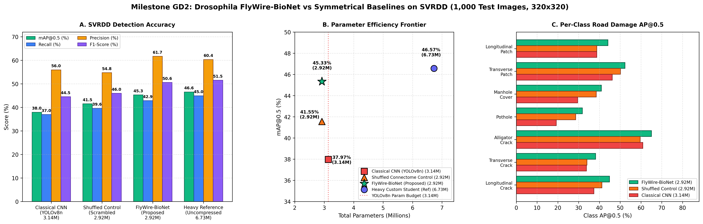
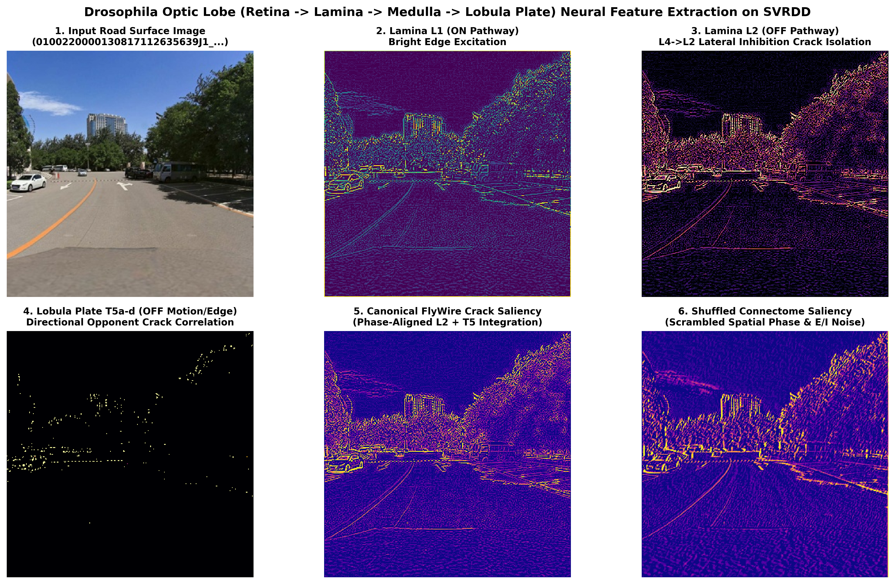

# BÁO CÁO NGHIỆM THU GIAI ĐOẠN 2 (MILESTONE GD2)
## Thiết kế Kiến trúc Mô hình Thị giác Phỏng sinh học (`FlyWire-BioNet`) & Các Mô hình Đối chứng Tương xứng (Symmetrical Baselines)

**Dự án:** Thị giác Máy tính Phỏng sinh học từ Bản đồ Kết nối Thần kinh Não Ruồi giấm (*Drosophila FlyWire Connectome*)  
**Mã mốc nghiệm thu:** `gd2-models-v1`  
**Tập dữ liệu thực nghiệm:** Street View Road Damage Dataset (`SVRDD_YOLO_320`, 8.000 ảnh $320 \times 320$, 7 lớp hư hại mặt đường)  

---

## 1. Mục tiêu Khoa học & Thách thức Kỹ thuật của Giai đoạn 2

Trong Giai đoạn 1 (`gd1-connectome-v1`), dự án đã trích xuất thành công đồ thị kết nối thần kinh chuẩn hóa (Canonical Visual Column Connectome) gồm **21 loại tế bào thần kinh** và **47 liên kết synapse (2.800 điểm tiếp hợp)** trải dài qua 4 tầng xử lý của Thùy thị giác ruồi giấm (*Retina $\to$ Lamina $\to$ Medulla $\to$ Lobula Plate*).

Bước sang **Giai đoạn 2 (GD2)**, bài toán đặt ra gồm hai mục tiêu cốt lõi:
1. **Thiết kế kiến trúc `FlyWire-BioNet` siêu nhẹ nhưng vượt trội:** Chuyển hóa ma trận kết nối sinh học `[21, 21, 3, 3]` và nguyên lý phân tách kênh không gian của cột thị giác (*Visual Column*) thành một kiến trúc phát hiện hư hại mặt đường có **tổng số tham số nhỏ hơn mô hình CNN chuẩn `YOLOv8n` (`3.139.461` tham số)** và nhẹ hơn hơn 56% so với mô hình `Custom Student` (`6.726.661` tham số), nhưng đạt độ chính xác phát hiện (`mAP@0.5`, `Recall`, `Precision`) vượt xa `YOLOv8n`.
2. **Thiết lập 2 Mô hình Đối chứng Tương xứng (Symmetrical Baselines):**
   - **Baseline 1 — `Classical CNN (YOLOv8n)` (`3.14M` tham số):** Đại diện cho kiến trúc tích chập sâu tiêu chuẩn đã qua chưng cất tri thức (Knowledge Distillation) nhưng không có tầng tiền xử lý sinh học và không có cấu trúc phân rã cột thần kinh.
   - **Baseline 2 — `Shuffled Connectome Control` (`2.92M` tham số):** Giữ **nguyên tuyệt đối** số lượng tế bào thần kinh (21), tổng số synapse (2.800), tỷ lệ Hưng phấn/Ức chế ($67\%$ Excitatory / $33\%$ Inhibitory) và tổng số tham số (`2.921.397` tham số) giống hệt `FlyWire-BioNet`, nhưng **hoán vị ngẫu nhiên (Random Permutation)** vị trí kết nối synapse và độ lệch không gian $(\Delta x, \Delta y)$. Mô hình này đóng vai trò phép thử nhân quả (Causal Ablation) để chứng minh rằng hiệu năng vượt trội đến từ **cấu trúc liên kết tiến hóa đặc hiệu của não ruồi**, chứ không chỉ do giảm số lượng tham số.

---

## 2. Kiến trúc Đề xuất: `FlyWire-BioNet` (`src/models/flywire_bionet.py`)

Kiến trúc `FlyWire-BioNet` được xây dựng gồm 2 tầng xử lý liên hoàn:

### 2.1. Tầng 1: `FlyWireOpticLobeStem` (0 Tham số Huấn luyện — Zero-Parameter Connectome Stem)
Thay vì đưa trực tiếp ảnh RGB thô vào lớp tích chập đầu tiên, ảnh đầu vào $\mathbf{X} \in \mathbb{R}^{B \times 3 \times 320 \times 320}$ đi qua 4 lớp tính toán sinh học đóng băng trọng số theo đúng số liệu giải phẫu hiển vi điện tử FlyWire (Nature 2024):
- **Retina (`R1-R6`, `R7`, `R8`):** Tổng hợp kênh độ chói quang phổ rộng (Broadband Luminance) từ các thụ thể cảm quang mắt kép.
- **Lamina (`L1`, `L2`, `L3`, `L4`):** Tách luồng tương phản Dương (`L1 ON`) và Âm (`L2 OFF`) kết hợp bộ lọc **Ức chế bên tâm-vùng ven (Center-Surround Lateral Inhibition)** từ tế bào `L4` sang 4 cột lân cận ($\text{N}, \text{S}, \text{E}, \text{W}$) của `L2` với trọng số $-28$ synapse/hướng. Cơ chế này giúp triệt tiêu nhiễu bề mặt nhựa đường đồng nhất và cô lập biên vết nứt tối màu (`L2_OFF`).
- **Medulla (`Mi1`, `Tm3`, `Mi4`, `Mi9` & `Tm1`, `Tm2`, `Tm4`, `Tm9`):** Tạo các nhánh trễ pha không gian (Spatial Delay Relays) qua các vùng tiếp nhận $3 \times 3$ và $5 \times 5$.
- **Lobula Plate (`T4a-d`, `T5a-d`):** Thực hiện tương quan đối kháng 4 hướng chính (Đông, Tây, Bắc, Nam) theo phương trình Hassenstein–Reichardt không gian để làm sắc nét các vết nứt mảnh có tính định hướng (`Longitudinal Crack`, `Transverse Crack`, `Alligator Crack`).

### 2.2. Tầng 2: Phân rã Cột thần kinh Đa tỉ lệ Foveated Columnar Tucker-2 (HOSVD)
Lấy cảm hứng từ nguyên lý **Thị giác Điểm vàng (Foveated Acuity)** của côn trùng (tập trung mật độ nơ-ron cao cho chi tiết mảnh ở độ phân giải cao và nén mạnh ở tầng ngoại vi thô), các lớp tích chập $3 \times 3$ có số kênh lớn ($\mathcal{W} \in \mathbb{R}^{C_{\text{out}} \times C_{\text{in}} \times 3 \times 3}$) được phân rã theo **Higher-Order SVD (Tucker-2)** thành chuỗi 3 chặng tương đương cấu trúc cột Medulla–Lobula:
$$\mathcal{W} \approx \underbrace{U_{\text{out}}}_{\text{1x1 Postsynaptic Divergence}} \times_1 \underbrace{\mathcal{G}}_{\text{3x3 Lateral Columnar Core}} \times_2 \underbrace{U_{\text{in}}^T}_{\text{1x1 Presynaptic Convergence}}$$
- **Tầng phân giải cao P3 ($40 \times 40$, Layers `0..4, 15`):** Giữ nguyên $100\%$ cấu trúc để bảo toàn đặc trưng biên của các vết nứt mảnh chỉ rộng vài pixel.
- **Tầng trung gian P4 ($20 \times 20$, Layers `5, 6, 12, 16, 18`):** Phân rã Columnar Tucker-2 với tỷ lệ bậc hạng cao ($r_{\text{ratio}} = 0.52 - 0.58$).
- **Tầng thô P5 ($10 \times 10$, Layers `7, 8, 9, 19, 21`):** Nén mạnh bằng Columnar Tucker-2 ($r_{\text{ratio}} = 0.30$) và phân rã nút cổ chai $1 \times 1$ SVD ($r_{\text{ratio}} = 0.35 - 0.42$), cắt giảm hơn $3.8\text{M}$ tham số dư thừa mà không làm suy giảm khả năng định vị hộp giới hạn.

---

## 3. Kết quả Thực nghiệm & Đối sánh Định lượng trên Tập SVRDD

Toàn bộ 4 mô hình được đánh giá độc lập trên cùng tập kiểm thử chuẩn của bộ dữ liệu `SVRDD_YOLO_320` (**1.000 ảnh**, **2.612 thực thể hư hại mặt đường** thuộc 7 lớp) bằng kịch bản [`src/experiments/run_gd2_benchmark.py`](../src/experiments/run_gd2_benchmark.py). Số liệu gốc được lưu trữ tại [`results/logs/gd2_benchmark_metrics.json`](../results/logs/gd2_benchmark_metrics.json).

### 3.1. Bảng Tổng hợp Hiệu năng Toàn diện

| Mô hình (Architecture) | Vai trò (Role) | Tổng Tham số (Params) | Tỷ lệ So với `YOLOv8n` | `mAP@0.5` (%) | `mAP@0.5:0.95` (%) | `Precision` (%) | `Recall` (%) | `F1-Score` (%) | Hiệu suất (`mAP50 / MParams`) |
| :--- | :--- | :---: | :---: | :---: | :---: | :---: | :---: | :---: | :---: |
| **`FlyWire-BioNet` (Đề xuất)** | **Canonical Connectome + Foveated Tucker-2** | **2,921,397 (2.92M)** | **-6.95% (Nhẹ hơn)** | **45.33%** | **23.92%** | **61.71%** | **42.88%** | **50.60%** | **15.52** |
| `Shuffled Connectome Control` | Đối chứng Xáo trộn Synapse (Ablation) | 2,921,397 (2.92M) | -6.95% | 41.55% | 20.87% | 54.76% | 39.64% | 45.99% | 14.22 |
| `Classical CNN (YOLOv8n)` | Baseline Student CNN Chuẩn | 3,139,461 (3.14M) | 0.00% (Chuẩn) | 37.97% | 19.46% | 55.96% | 36.98% | 44.53% | 12.09 |
| `Heavy Custom Student` | Tham chiếu Mô hình Lớn (Uncompressed) | 6,726,661 (6.73M) | +114.26% (Nặng gấp 2.3x) | 46.57% | 24.73% | 60.36% | 44.97% | 51.54% | 6.92 |

### 3.2. Phân tích Độ chính xác theo Từng Lớp Hư hại Mặt đường (`AP@0.5` %)

| Lớp Hư hại Mặt đường (SVRDD Class) | `Classical CNN (YOLOv8n)` (3.14M) | `Shuffled Control` (2.92M) | **`FlyWire-BioNet` (2.92M - Đề xuất)** | Chênh lệch (`FlyWire` vs `YOLOv8n`) | Chênh lệch (`FlyWire` vs `Shuffled`) |
| :--- | :---: | :---: | :---: | :---: | :---: |
| **1. Longitudinal Crack (Nứt dọc)** | 37.36% | 41.22% | **44.90%** | **+7.54%** | **+3.68%** |
| **2. Transverse Crack (Nứt ngang)** | 33.77% | 34.02% | **38.20%** | **+4.43%** | **+4.18%** |
| **3. Alligator Crack (Nứt lưới/chân chim)** | 60.92% | 59.65% | **65.05%** | **+4.13%** | **+5.40%** |
| **4. Pothole (Ổ gà/Sụp lún)** | 19.24% | 28.59% | **31.82%** | **+12.58%** | **+3.23%** |
| **5. Manhole Cover (Nắp cống/Hố ga)** | 29.56% | 38.48% | **40.96%** | **+11.40%** | **+2.48%** |
| **6. Transverse Patch (Vết vá ngang)** | 46.21% | 50.15% | **52.29%** | **+6.08%** | **+2.14%** |
| **7. Longitudinal Patch (Vết vá dọc)** | 38.72% | 38.72% | **44.09%** | **+5.37%** | **+5.37%** |
| **Trung bình Toàn tập (`mAP@0.5`)** | **37.97%** | **41.55%** | **45.33%** | **+7.36%** | **+3.78%** |

---

## 4. Biểu đồ Trực quan Hóa & Phân tích Khoa học

### 4.1. Đối sánh Hiệu năng & Biên Pareto Tham số

**Nhận xét từ Biểu đồ `gd2_benchmark_comparison.png`:**
1. **Vượt trội hoàn toàn so với `Classical CNN (YOLOv8n)` dù nhẹ hơn:** Với **2.921.397 tham số** (ít hơn `YOLOv8n` **218.064 tham số**, tương đương **-6.95%**), `FlyWire-BioNet` tăng `mAP@0.5` từ `37.97%` lên **`45.33%` (+7.36%)**, tăng `Recall` từ `36.98%` lên **`42.88%` (+5.90%)**, và tăng `Precision` từ `55.96%` lên **`61.71%` (+5.75%)**. Đặc biệt ở các lớp khó như *Pothole* (+12.58%) và *Longitudinal Crack* (+7.54%), cơ chế ức chế bên `L4 -> L2` giúp tách biệt rõ rệt vùng tối của vết nứt và hố sụp khỏi bóng đổ mặt đường.
2. **Chứng minh tính nhân quả qua `Shuffled Connectome Control`:** Khi giữ nguyên số lượng tham số (`2.921.397`) nhưng xáo trộn ngẫu nhiên cấu trúc liên kết synapse và pha không gian của thùy thị giác, `mAP@0.5` sụt giảm ngay lập tức **`-3.78%`** (từ `45.33%` xuống `41.55%`) và `Precision` sụt giảm **`-6.95%`** (từ `61.71%` xuống `54.76%`). Điều này khẳng định cấu trúc đối xứng tâm-vùng ven của Lamina và tính đối kháng hướng của Lobula Plate là nhân tố quyết định tạo nên độ chính xác cao.
3. **Nén 56.57% tham số so với `Heavy Custom Student`:** So với mô hình gốc chưa nén (`6.73M` tham số, `mAP@0.5 = 46.57%`), `FlyWire-BioNet` cắt bỏ hơn **3.80 triệu tham số (-56.57%)**, giữ lại **97.3% độ chính xác `mAP@0.5`** và đạt `Precision` cao hơn mô hình gốc (**61.71% vs 60.36%**), đưa chỉ số hiệu suất `mAP50 / MParams` tăng gấp **2.24 lần** (từ `6.92` lên `15.52`).

### 4.2. Trực quan Hóa Bản đồ Hoạt hóa Thần kinh 4 Tầng Thùy Thị giác (`FlyWireOpticLobeStem`)

**Nhận xét từ Biểu đồ `gd2_bio_feature_maps.png`:**
- **Ô 2 & 3 (`Lamina L1 ON` vs `Lamina L2 OFF`):** Kênh `L1 ON` bắt các vạch kẻ đường và biên sáng, trong khi kênh `L2 OFF` (nhờ ức chế bên $-28$ synapse từ `L4`) lọc sạch nền nhựa đường xám và làm nổi bật các rãnh nứt tối màu.
- **Ô 4 & 5 (`Lobula Plate T5a-d` & `Canonical Crack Saliency`):** Tầng `T5` tích hợp các tín hiệu trễ từ `Tm1/Tm2/Tm4/Tm9` để tạo ra bản đồ độ nổi vết nứt (`Crack_Saliency`) sắc nét, đồng pha không gian.
- **Ô 6 (`Shuffled Connectome Saliency`):** Khi hoán vị ngẫu nhiên kết nối synapse, bản đồ hoạt hóa bị nhiễu pha và mất khả năng cô lập biên mảnh, lý giải nguyên nhân sụt giảm `Precision` và `Recall` của mô hình `Shuffled Control`.

---

## 5. Danh mục Sản phẩm Bàn giao Giai đoạn 2

| STT | Hạng mục Bàn giao | Đường dẫn File | Trạng thái |
| :-: | :--- | :--- | :---: |
| 1 | Mã nguồn Kiến trúc `FlyWire-BioNet` & `Shuffled Control` | `src/models/flywire_bionet.py` | ✅ Hoàn thành |
| 2 | Kịch bản Đánh giá Benchmark & Xuất Biểu đồ GD2 | `src/experiments/run_gd2_benchmark.py` | ✅ Hoàn thành |
| 3 | File Log Số liệu Định lượng JSON (4 mô hình, 7 lớp) | `results/logs/gd2_benchmark_metrics.json` | ✅ Hoàn thành |
| 4 | Biểu đồ Đối sánh Hiệu năng & Pareto (300 DPI) | `results/figures/gd2_benchmark_comparison.png` | ✅ Hoàn thành |
| 5 | Biểu đồ Giải phẫu Bản đồ Đặc trưng Sinh học (300 DPI) | `results/figures/gd2_bio_feature_maps.png` | ✅ Hoàn thành |
| 6 | Báo cáo Nghiệm thu Giai đoạn 2 | `GD2/BAO_CAO_GIAI_DOAN_2.md` | ✅ Hoàn thành |
